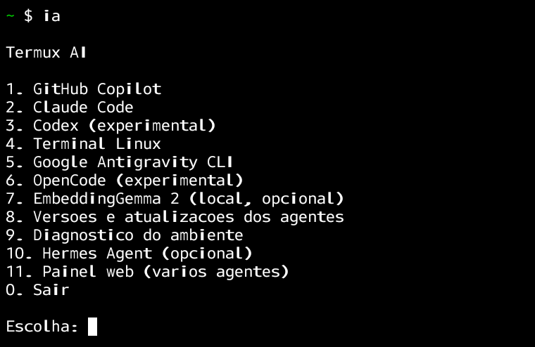
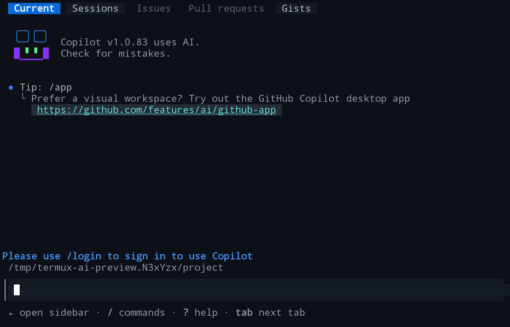
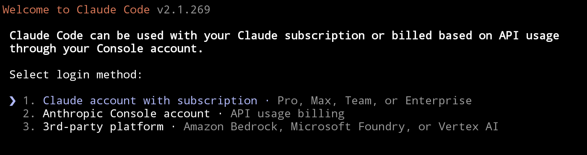
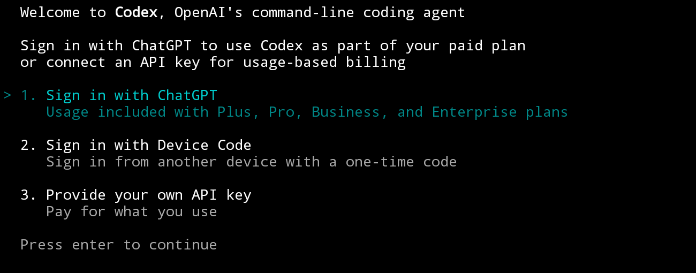
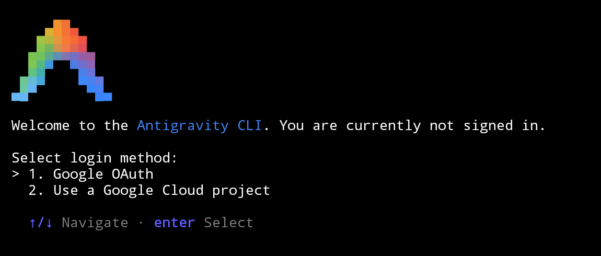
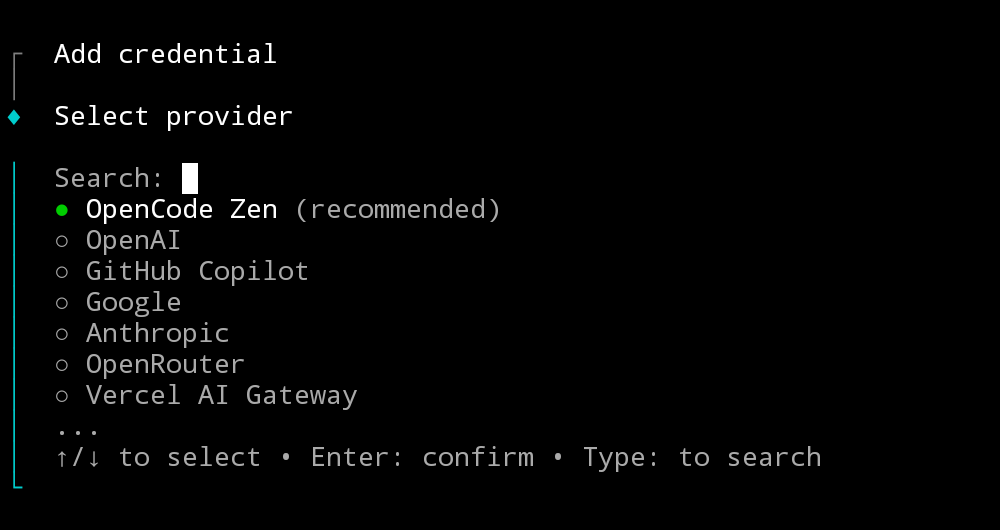
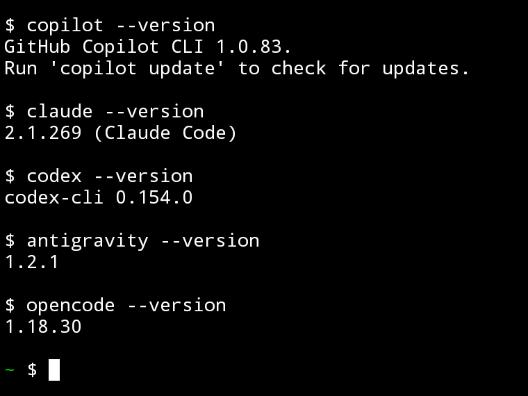

<div align="center">

# AI Termux Android

**Programe com IA direto do seu Android.**

GitHub Copilot &middot; Claude Code &middot; Codex &middot; Antigravity &middot; OpenCode

[](https://github.com/micheljatuba/AI-Termux-Android/actions/workflows/checks.yml)


[](#compatibilidade)

[Instalar](#instalacao) &middot; [Primeiro uso](#primeiro-uso) &middot; [Na tela](#na-tela) &middot; [Atualizar](#atualizar) &middot; [Diagnostico](#diagnostico) &middot; [Compatibilidade](#compatibilidade) &middot; [Ajuda](#ajuda)

</div>

Da ideia ao codigo, sem abrir um notebook. Tenha **Copilot, Claude Code, Codex,
Antigravity e OpenCode** no mesmo ambiente, junto com Git, GitHub CLI e Node.js.
Escolha seu agente, abra um projeto e continue de onde estiver.

**Cinco agentes. Um menu. Seus projetos no Android.** Sem root no Android e
sem depender de um PC no uso diario.

<p align="center">
    
    <br>
    <sub>Abra com ia. Escolha pelo numero. Comece no seu projeto.</sub>
</p>

**Testado no Android:** instalacao, menu, atalhos e acesso aos cinco agentes
com login e API. Veja os [requisitos e limites](#compatibilidade).

Os modelos em nuvem precisam de **internet e uma conta no provedor escolhido**.
Assinaturas, creditos e limites de uso nao estao incluidos neste projeto.

## O que voce pode criar

| Sua proxima ideia | Como usar o ambiente |
| --- | --- |
| Um script que resolve uma tarefa repetitiva | Descreva a tarefa ao agente, revise o codigo e teste no terminal |
| Um projeto que voce quer entender | Abra a pasta e peca uma explicacao da estrutura e dos pontos principais |
| Uma correcao que nao pode esperar | Investigue o erro, revise a sugestao e execute os testes do projeto |
| Uma segunda opiniao sobre seu codigo | Alterne entre os agentes na mesma pasta e compare as propostas |
| Um projeto pronto para compartilhar | Use Git e GitHub CLI para revisar alteracoes e publicar seu trabalho |

O agente muda. **A pasta do projeto continua a mesma.** Cada CLI mantem sua
propria conta e conversa; voce escolhe a ferramenta para cada etapa.

## Instalacao

### 1. Prepare o Termux

Instale o **Termux oficial** pela [Google Play](https://play.google.com/store/apps/details?id=com.termux),
[F-Droid](https://f-droid.org/en/packages/com.termux/) ou
[GitHub do Termux](https://github.com/termux/termux-app/releases).

| Requisito | Minimo previsto |
| --- | --- |
| Sistema | Android 11 ou superior |
| Arquitetura do Termux | ARM64 (`aarch64`) ou `x86_64` |
| Espaco livre | 6 GiB para instalar e atualizar |
| Memoria | 4 GB de RAM; 8 GB recomendados |
| Pacotes | A variante do Termux deve oferecer PRoot-Distro 5.3.0+ |

> [!IMPORTANT]
> Nao misture aplicativos, plugins ou repositorios de variantes diferentes do
> Termux. Preserve seus dados antes de trocar uma instalacao existente.
> iOS e aplicativos homonimos da App Store nao sao suportados.

### 2. Instale os agentes

No **Termux**, execute o bloco abaixo. O instalador verifica o ambiente e pede
confirmacao antes de instalar pacotes.

```sh
pkg update && pkg install -y git
git clone https://github.com/micheljatuba/AI-Termux-Android.git ~/AI-Termux-Android
cd ~/AI-Termux-Android
bash install.sh --check
bash install.sh
```

Mantenha o projeto na home privada do Termux, fora de Download ou do armazenamento
compartilhado. Revise os scripts antes de executar; baixe o repositorio completo.

Os downloads diretos do instalador Claude e do manifesto/pacote Antigravity
limitam a conexao a 15 segundos e cada tentativa a 5 minutos. Falhas transitorias
podem receber ate duas novas tentativas; o curl deixa de iniciar novas tentativas
apos 10 minutos. Esses limites nao abrangem os comandos `pkg`, `npm`, `apt-get`
nem downloads internos dos instaladores dos fornecedores. Se a instalacao falhar,
aguarde a execucao terminar e rode `bash install.sh` novamente; nao apague o Linux.

> [!NOTE]
> Ja tem um menu `ia` ou Ubuntu configurado manualmente? Veja
> [Instalacoes existentes](#instalacoes-existentes). O instalador nao substitui
> comandos ou ambientes de outra origem.

### 3. Abra o menu

```sh
ia
```

O menu tambem aparece em novas sessoes **Bash** do Termux. Escolha o numero do
agente e pressione Enter. A opcao `7` abre o EmbeddingGemma 2 local (opcional),
`8` atualiza os agentes e `9` faz o [diagnostico](#diagnostico). Para consultar
versoes, execute `ia versoes`. Use `0` para voltar ao shell.

## Acesso pelo navegador

No Termux, execute:

```sh
ia web
```

Isso inicia um terminal Linux com menu em `http://127.0.0.1:7680` e, quando o
EmbeddingGemma opcional estiver instalado, sua interface em
`http://127.0.0.1:8085`. O terminal permite abrir os agentes instalados e
continuar em pastas do Ubuntu. Para iniciar ou consultar um servico apenas:
`ia web start terminal`, `ia web start embedding` ou `ia web status`. Encerre
com `ia web stop`.

As duas interfaces escutam **somente em 127.0.0.1** e nao aceitam conexoes de
outros aparelhos no Wi-Fi. Nao altere o endereco de escuta para `0.0.0.0`.
O instalador inclui `ttyd` no Linux e aciona `termux-wake-lock` automaticamente
quando disponivel, evitando que o Android suspenda os servicos ao alternar para
o navegador (`ia web stop` libera o wake-lock). Para habilitar o EmbeddingGemma,
execute no Termux:

```sh
ia embeddinggemma install
```

Esse comando instala Python e as dependencias opcionais (`sentence-transformers`,
`fastapi` e `uvicorn`) no Linux. Reserve alguns GiB; a primeira inferencia baixa
o modelo (cerca de 1,5 GiB) e pode levar mais tempo. Busca de arquivos fica
restrita a pasta atual de onde `ia web` foi iniciado.

<details>
<summary>Opcoes de instalacao</summary>

| Opcao | O que faz |
| --- | --- |
| `bash install.sh --check` | Verifica o ambiente sem instalar nem modificar arquivos |
| `bash install.sh --no-menu` | Instala os comandos sem abrir o menu automaticamente |
| `bash install.sh --yes` | Confirma a instalacao sem pergunta interativa |
| `bash install.sh --adopt-ubuntu` | Integra um Ubuntu e um menu `ia` manuais; veja [Instalacoes existentes](#instalacoes-existentes) |

`--yes` nao autoriza acoes futuras dos agentes. Para desativar um menu automatico
ja gerenciado por este projeto, execute novamente com `--no-menu`.
Outros shells podem usar `ia` manualmente; conexoes SSH e shells nao interativos
nao recebem o menu.

</details>

## Primeiro uso

Conecte a conta de cada agente, seguindo o fluxo oficial no navegador ou no
terminal. As contas de outros agentes **nao sao copiadas automaticamente**.

| Agente | Abrir | Conectar a conta |
| --- | --- | --- |
| GitHub Copilot CLI | `copilot` | `copilot login` |
| Claude Code | `claude` | `claude auth login` |
| Codex | `codex` | `codex login` |
| Google Antigravity CLI | `antigravity` ou `agy` | Siga o fluxo ao abrir |
| OpenCode | `opencode` | `opencode auth login` ou `/connect` na interface |

Se o navegador nao abrir, use o link exibido pelo agente. Planos, limites e
cobranca dependem de cada provedor; este projeto nao fornece assinaturas ou
creditos. No OpenCode, `opencode models` lista os modelos disponiveis.

**OpenCode sem chave de API:** em `opencode auth login`, escolha **GitHub
Copilot** para entrar com a assinatura do Copilot por codigo de dispositivo,
ou **OpenAI** e depois **ChatGPT Plus/Pro** para usar a assinatura do ChatGPT.
Depois de conectar as contas, confira tudo com `ia diagnostico`.

**Abra o agente dentro da pasta em que deseja trabalhar:**

```sh
mkdir -p ~/projetos/meu-projeto
cd ~/projetos/meu-projeto
copilot
```

Os atalhos preservam a pasta atual e os argumentos. Use `ia terminal` para abrir
o Linux e executar `git`, `gh`, `node` e `npm` no mesmo projeto.

### Na tela

Veja a interface antes de conectar sua conta. As capturas abaixo mostram as
CLIs reais em perfis de demonstracao vazios, sem credenciais ou conversas.

<details open>
<summary>GitHub Copilot CLI</summary>

**Opcao 1 no menu** ou `copilot`. A entrada mostra a area de conversa e o
comando `/login` para conectar sua conta.



</details>

<details>
<summary>Claude Code</summary>

**Opcao 2 no menu** ou `claude`. Escolha o metodo de conexao oferecido pela
CLI, incluindo conta Claude ou Anthropic Console para uso de API.



</details>

<details>
<summary>Codex</summary>

**Opcao 3 no menu** ou `codex`. A tela de boas-vindas oferece conexao com
ChatGPT, codigo de dispositivo ou sua propria chave de API. No Android, o
Codex abre no modo **Pedir aprovacao**; veja [Codex no Android](#codex-no-android).



</details>

<details>
<summary>Google Antigravity CLI</summary>

**Opcao 5 no menu** ou `antigravity`. A tela de entrada oferece Google OAuth
ou conexao por um projeto Google Cloud, conforme o fluxo do fornecedor.



</details>

<details>
<summary>OpenCode</summary>

**Opcao 6 no menu** ou `opencode`. Para conectar uma conta, `opencode auth login`
abre a selecao de provedores mostrada abaixo. Escolha o seu e siga o fluxo
de autenticacao antes de inserir qualquer credencial.



</details>

<details>
<summary>Versoes dos cinco agentes</summary>

**Cinco executaveis, uma instalacao.** Abaixo, a saida real dos comandos
`--version` executados pelos atalhos do Termux:



<sub>Captura real do terminal. As interfaces e versoes podem mudar com as
atualizacoes dos fornecedores.</sub>

</details>

### Codex no Android

**O sandbox do Codex nao funciona no Android.** O Android nao oferece Landlock,
e o bubblewrap usado pelo Codex nao consegue montar o isolamento no PRoot. No
modo padrao do Codex, os comandos do agente falham sem pedir aprovacao.

Por isso, `codex`, `ia codex` e a opcao 3 do menu abrem o Codex no modo
**Pedir aprovacao** (`-s workspace-write -a on-request`), com um aviso curto.
Cada comando ou edicao pede sua confirmacao: aprovar executa a acao fora do
sandbox; recusar a bloqueia.

| Ao abrir o Codex | O que acontece |
| --- | --- |
| `codex`, `codex resume` ou `codex fork` | Abre no modo Pedir aprovacao |
| Com uma opcao de permissao, como `-s`, `-a`, `-p` ou `--full-auto` | Usa o modo informado, sem alteracao |
| `codex exec` ou `codex review` | Mostra um aviso: sem o sandbox, os comandos do agente falham |
| `codex login`, `codex --help` e os demais subcomandos | Executa sem alteracao |

Revise cada pedido antes de aprovar e mantenha os projetos no Git ou com
backup. O [diagnostico](#diagnostico) testa o sandbox do Codex e avisa se uma
versao futura passar a inicia-lo sem bloquear gravacoes; nesse caso, comandos
poderiam rodar sem aprovacao.

O Codex tambem inicia um servidor local em segundo plano. Ao fechar o Codex
aberto pelo menu ou por `ia codex`, o PRoot-Distro encerra os processos do
Linux, inclusive esse servidor. Por isso, a mensagem "Any running work
continues", exibida ao sair, nao vale aqui: espere a tarefa terminar antes de
sair e use `ia codex resume` para retomar a conversa.

Esse servidor e um pacote separado, que o npm e o `ia atualizar` nao trocam.
Depois de atualizar o Codex, ele pode avisar que o servico em segundo plano e
mais antigo que o CLI. O aviso nao impede o uso; para atualizar o servico,
digite `/daemon` no Codex, como o proprio aviso indica. Os avisos sobre
bubblewrap tambem sao esperados: instala-lo nao resolve, porque no PRoot ele
nao isola de verdade.

## Como funciona

**Android + Termux** &rarr; **Menu ia e atalhos** &rarr; **Linux via PRoot**
&rarr; **CLI escolhida** &rarr; **Provedor de IA**

1. **Verifica o ambiente:** Android, arquitetura, espaco livre e conflitos com comandos existentes.
2. **Prepara o Linux:** instala o PRoot oficial e cria o ambiente `termux-ai`, usando Debian com Node.js 24, ou reaproveita um Ubuntu existente com `--adopt-ubuntu`.
3. **Instala as CLIs oficiais:** instala as ausentes ou abaixo da versao validada, nunca rebaixa as mais novas e verifica os executaveis, sem pedir logins nem chamar modelos.
4. **Cria os atalhos:** adiciona `ia` e os comandos dos agentes, com menu automatico opcional.

O ambiente inclui **Git, GitHub CLI, ripgrep, nano e Node.js**. Os agentes rodam
como o usuario Linux `node` (no Ubuntu adotado, como o root simulado do PRoot),
sem root real no Android. A imagem base e
`node:24-bookworm-slim`; nao e necessario instalar ou executar Docker.

Isso nao transforma Android em Windows. PRoot fornece um ambiente Linux sobre
o kernel do Android, com limitacoes de compatibilidade e isolamento.

## Atualizar

**Consulte e atualize os agentes pelo Termux:**

```sh
ia versoes
ia atualizar
```

`ia versoes` compara a versao instalada de cada agente com a mais recente
publicada no npm e no manifesto oficial do Antigravity. `ia atualizar` mostra
o plano, pede confirmacao e verifica cada agente com `--version` depois da
instalacao. A opcao `8` do menu tambem atualiza os agentes.

| Comando | O que faz |
| --- | --- |
| `ia versoes` | Mostra a versao instalada, a disponivel e a situacao dos cinco agentes |
| `ia atualizar` | Atualiza os agentes desatualizados apos confirmacao |
| `ia atualizar claude codex` | Limita a atualizacao aos agentes informados |
| `ia atualizar --yes` | Confirma o plano sem pergunta interativa |

Feche os agentes antes de atualizar. Cada atualizacao reaproveita o local em
que o agente ja esta instalado: prefixo npm, instalador nativo do Claude Code
ou binario do Antigravity. Contas e conversas sao mantidas. Depois de atualizar
o Codex, ele pode avisar que o servico em segundo plano esta desatualizado;
veja [Codex no Android](#codex-no-android).

Para atualizar o menu e os scripts deste projeto, saia dos agentes e execute:

```sh
cd ~/AI-Termux-Android
git pull --ff-only
bash install.sh
```

O Linux e seus dados sao reaproveitados. Use `--no-menu` novamente se nao
deseja o menu automatico. Comandos personalizados nao sao sobrescritos.

<details>
<summary>Versoes validadas e verificacoes</summary>

O instalador garante pelo menos Codex 0.159.3, Copilot 1.0.90, Claude Code
2.1.286 e OpenCode 1.18.34, versoes validadas no Android. **Versoes iguais ou
mais novas sao mantidas: reexecutar o instalador nunca rebaixa um agente.**
Antigravity segue seu manifesto oficial. Atualizacoes dos fornecedores podem
mudar a compatibilidade.

Para conferir as versoes diretamente pelo Termux:

```sh
copilot --version
claude --version
codex --version
antigravity --version
opencode --version
```

No OpenCode, o instalador executa explicitamente apenas o pos-instalador oficial,
sem liberar scripts globalmente no npm. O download do Antigravity verifica o
dominio do pacote, a versao anunciada e o SHA-512 antes de instalar o binario.
O configurador de aliases e perfis do Antigravity nao e executado.

</details>

## Diagnostico

**Confira o ambiente, os agentes e os logins com um comando no Termux:**

```sh
ia diagnostico
```

Execute na pasta do projeto; a opcao `9` do menu faz o mesmo. O diagnostico
nao chama modelos nem altera seus arquivos e termina com os proximos passos,
como o comando de login de um agente desconectado.

| Parte | O que verifica |
| --- | --- |
| Termux | Versoes do Android, Termux e PRoot-Distro, espaco livre e o Linux em uso |
| Linux | Sistema, Node.js 22+, Git, acesso a internet e gravacao na pasta atual |
| Agentes | Versao e login de cada agente, sem exibir contas, emails ou tokens |
| Recursos locais | Situacao do EmbeddingGemma 2 (cache local) e dos servicos `ia web` |
| Protecao | Se o sandbox do Codex funciona e os limites de isolamento do PRoot |

O login e lido do estado local de cada CLI: `codex login status`,
`claude auth status`, a configuracao do Copilot, `opencode auth list` e o token
do Antigravity. Um token do Copilot em variavel de ambiente tambem conta como
login. Inclua a saida do diagnostico ao [relatar um problema](#ajuda).

## Instalacoes existentes

**Ja usa Ubuntu e um menu `ia` manual no Android?** A adocao passa os comandos
para o menu gerenciado e reaproveita o Ubuntu, sem reinstalar o Linux nem pedir
novos logins. Clone este repositorio, caso ainda nao o tenha, usando o comando da
[instalacao](#instalacao). Depois, no Termux e **fora do Ubuntu**:

```sh
cd ~/AI-Termux-Android
git pull --ff-only
bash install.sh --adopt-ubuntu --check
bash install.sh --adopt-ubuntu
```

- Usa o Ubuntu do PRoot-Distro com o usuario root ja configurado. Contas,
  projetos e agentes em versao igual ou mais nova que a validada sao mantidos.
- Instala Git, GitHub CLI, ripgrep e nano, se faltarem, e os agentes ausentes
  ou abaixo da versao validada. O Ubuntu precisa de Node.js 22 ou superior.
- Substitui `ia` e os comandos dos agentes pelo menu gerenciado. Os anteriores
  ficam em `~/.local/share/termux-ai/adopted/bin`.
- Remove do `~/.bashrc` somente o bloco exato que abria o menu manual e
  acrescenta a linha do menu gerenciado. A copia anterior fica em
  `~/.local/share/termux-ai/bashrc.before`.

A adocao reconhece o menu manual que termina em
`exec proot-distro login ubuntu --work-dir "$PWD"`, links para ele e copias
identicas. Com outro formato ou comandos de outra origem, ela para sem alterar
nada. Depois da adocao, `bash install.sh` atualiza o menu e `ia atualizar`
atualiza os agentes.

<details>
<summary>Desfazer a adocao</summary>

Feche os agentes e execute no Termux para voltar ao menu manual. Somente os
comandos identicos ao menu gerenciado sao trocados pelas copias de seguranca.
O `~/.bashrc` volta a versao anterior a adocao; o atual fica em
`~/.bashrc.termux-ai-undo`, caso voce o tenha alterado depois.

```sh
s=~/.local/share/termux-ai
if grep -qx 'name=ubuntu' "$s/linux.conf" 2>/dev/null; then
    ok=1
    for t in ia codex copilot claude antigravity agy opencode embeddinggemma embedding; do
        f="$PREFIX/bin/$t"
        b="$s/adopted/bin/$t"
        if [ -f "$s/bin/ia" ] && [ ! -L "$f" ] && cmp -s "$f" "$s/bin/ia"; then
            rm -f "$f" || ok=0
        fi
        if { [ -e "$b" ] || [ -L "$b" ]; } && [ ! -e "$f" ] && [ ! -L "$f" ]; then
            cp -P -p "$b" "$f" || ok=0
        fi
    done
    if [ "$ok" = 1 ] && [ -f "$s/bashrc.before" ]; then
        if [ -f ~/.bashrc ]; then cp -p ~/.bashrc ~/.bashrc.termux-ai-undo || ok=0; fi
        if [ "$ok" = 1 ]; then cp "$s/bashrc.before" ~/.bashrc || ok=0; fi
    fi
    if [ "$ok" = 1 ]; then
        rm -rf "$s"
        echo 'Adocao desfeita. Abra uma nova sessao do Termux.'
    else
        echo "Falha ao desfazer. As copias continuam em $s/adopted/bin."
    fi
else
    echo 'Nenhuma adocao do Ubuntu encontrada; nada foi alterado.'
fi
```

Repetir os comandos nao altera mais nada. Tambem e seguro executa-los apos uma
adocao interrompida: o menu manual e mantido. O Ubuntu, as contas e os agentes
atualizados continuam como estao.

</details>

<details>
<summary>Acrescentar apenas o OpenCode ao menu manual</summary>

Para manter o menu manual e acrescentar somente o OpenCode, sem adotar o Ubuntu:

```sh
cd ~/AI-Termux-Android
git pull --ff-only
bash scripts/add-opencode-ubuntu.sh
ia
```

O complemento reconhece o menu Ubuntu com Antigravity na opcao 5 e acrescenta
OpenCode na opcao 6. Preserva as opcoes anteriores e salva uma copia do menu
em `~/.cache/termux-ai-opencode.*`. Se o formato for desconhecido ou existir
um comando `opencode` de outra origem, ele para sem substituir o menu.
Nao e uma migracao generica de qualquer instalacao Ubuntu.

</details>

## Compatibilidade

**Testado no Android, sem root.** Instalacao, menu, atalhos, versao e ajuda
dos cinco agentes verificados. Login e acesso via API nos cinco agentes
tambem foram confirmados pelo usuario.

O projeto atende a **Android 11+ com Termux de 64 bits**. O resultado depende
da configuracao do Android, da versao da CLI e do provedor escolhido.
Autenticar nao garante que toda ferramenta ou sandbox funcione no PRoot.

<details>
<summary>Limites conhecidos e solucao de problemas</summary>

- **Codex:** o sandbox nao funciona no PRoot. O menu e o atalho `codex` abrem o Codex no modo Pedir aprovacao; `codex exec` e `codex review` nao conseguem executar comandos. Veja [Codex no Android](#codex-no-android).
- **OpenCode:** o login foi confirmado; ferramentas, plugins e tarefas dependem do provedor e das permissoes. O menu ainda usa a marcacao experimental para essa integracao.
- **Antigravity:** o login Linux pode depender de Secret Service/D-Bus; persistencia de credenciais nao e garantida em todas as configuracoes PRoot.
- **Arquitetura:** um processador de 64 bits com Termux de 32 bits nao atende aos requisitos.
- **Repositorios:** se a sua variante nao oferece PRoot-Distro 5.3.0+, nao misture repositorios para forcar a instalacao.
- **Conflitos:** comandos dos agentes de outra origem nao sao substituidos. Para o menu Ubuntu manual, use a [adocao](#instalacoes-existentes).
- **Interrupcao:** se a execucao anterior ja terminou, volte a `~/AI-Termux-Android` e execute `bash install.sh` novamente. O ambiente gerenciado e reaproveitado. Se houver aviso de `install.lock`, confirme que nao existe outra instalacao ativa antes de agir; nao apague o Linux como tentativa de reparo.

Referencias: [Termux](https://github.com/termux/termux-app#installation),
[PRoot-Distro](https://github.com/termux/proot-distro),
[Antigravity](https://antigravity.google/docs/cli/install) e
[OpenCode](https://opencode.ai/docs/cli/).

</details>

## Ajuda

<details>
<summary>Preciso de PC, cabo USB ou root?</summary>

Nao. Instale diretamente no Termux e use no Android. O projeto nao exige
root, PC, cabo USB ou depuracao USB para instalar e usar os agentes.

</details>

<details>
<summary>Os modelos rodam no aparelho? Posso usar sem internet?</summary>

As CLIs e as ferramentas de desenvolvimento rodam no Android, dentro do Linux
via PRoot. Os modelos dos provedores em nuvem dependem de internet e de uma
conta. O EmbeddingGemma 2 e opcional: depois de instalar suas dependencias,
gera embeddings localmente; o modelo e baixado na primeira inferencia.

</details>

<details>
<summary>O projeto inclui os planos dos provedores?</summary>

Nao. Cada provedor define autenticacao, modelos, limites e cobranca. Ter uma
assinatura em um servico nao conecta nem libera automaticamente os outros.

</details>

**Encontrou um problema?** [Abra uma issue](https://github.com/micheljatuba/AI-Termux-Android/issues/new)
com a saida de `ia diagnostico`, o comando executado e a mensagem de erro. Se a
instalacao nao terminou, informe a versao do Android e do Termux e a arquitetura.
Remova tokens, emails, caminhos pessoais e outros dados privados antes de enviar
logs ou capturas. Informe se e uma instalacao nova ou uma atualizacao.

## Seguranca e backups

> [!WARNING]
> **PRoot nao e um sandbox de seguranca.** Os agentes podem acessar arquivos
> disponiveis ao Termux. Revise as permissoes e mantenha backups dos projetos.

O instalador nao desativa sandboxes, nao habilita aprovacao irrestrita, nao
configura compartilhamento automatico de sessoes e nao abre acesso SSH/ADB.
As permissoes dos agentes seguem os padroes de cada fornecedor. A excecao e o
Codex: sem sandbox no Android, ele abre no modo Pedir aprovacao, que confirma
cada comando ou edicao.

Digite chaves somente no prompt oficial do agente. Nao publique credenciais,
logs privados ou backups. No OpenCode, as credenciais ficam em
`~/.local/share/opencode/auth.json`, dentro do Linux em que ele roda.
O terminal web concede ao usuario da sessao os mesmos acessos que um shell
Linux local; mantenha-o em `127.0.0.1` e encerre-o com `ia web stop` ao terminar.

<details>
<summary>Onde ficam os dados e como fazer backup</summary>

O estado do instalador fica em `~/.local/share/termux-ai` no Termux. Quando havia
um arquivo Bash anterior, sua copia e preservada em
`~/.local/share/termux-ai/bashrc.before`. O menu usa apenas uma linha adicional
de carregamento nesse arquivo. Na adocao, os comandos anteriores ficam em
`~/.local/share/termux-ai/adopted/bin`.

Para copiar o Linux dedicado, escolha um nome de arquivo ainda inexistente:

```sh
proot-distro backup termux-ai --output ~/termux-ai-backup.tar.gz
```

No Ubuntu adotado, use `ubuntu` no lugar de `termux-ai`.
Esse backup pode conter credenciais. Guarde-o em local privado. Projetos na
home do Termux, fora do Linux dedicado, precisam de backup separado.
Nao use `proot-distro reset` ou `remove` como reparo sem backup: eles apagam
os dados do ambiente.

</details>

## Desenvolvimento

Os testes exigem Bash, Python 3.10+, Node.js 22+ e utilitarios GNU, incluindo
`tar` e `sha512sum`.

```sh
python3 -m py_compile scripts/embeddinggemma_cli.py scripts/embeddinggemma_web.py
bash tests/run.sh
shellcheck --severity=warning install.sh bin/ia scripts/setup-linux.sh scripts/add-opencode-ubuntu.sh scripts/menu.bash scripts/webui.sh scripts/web-menu.sh scripts/embeddinggemma-launcher.sh tests/run.sh
```

A suite verifica argumentos, conflitos, preservacao de configuracoes,
repeticao da instalacao, validacao de downloads, consulta e atualizacao de
versoes sem rebaixamento, adocao do Ubuntu manual, atualizacao do menu Ubuntu,
diagnostico do ambiente e o modo Pedir aprovacao do Codex.
Execute-a em Linux; no Android, rode-a dentro do Linux do PRoot com `ia terminal`.
Antes de anunciar suporte a uma nova configuracao Android, teste instalacao,
login e uma tarefa controlada em cada agente, sem publicar dados pessoais.

---

Projeto independente de integracao. Termux, as CLIs e os servicos de IA
continuam sujeitos as licencas e condicoes dos respectivos fornecedores.

**Mais gente criando com IA no Android.** Marque este repositorio com uma
estrela para encontra-lo depois e compartilhe o guia com quem quer programar
sem depender de um PC.

[Relatar um problema](https://github.com/micheljatuba/AI-Termux-Android/issues/new) &middot; [Ver testes](https://github.com/micheljatuba/AI-Termux-Android/actions) &middot; [Voltar ao topo](#ai-termux-android)
